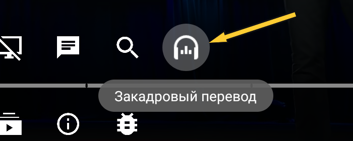

# SmartTube Russian Voice Over & Comments

Русская озвучка видео и перевод комментариев в SmartTube для Android TV.
Независимый форк SmartTube со встроенным Яндекс VOT; на телевизоре приложение
называется **SmartTube VOT**.

**[Скачать APK](https://github.com/mikhkz/SmartTube-Russian-VoiceOver-and-Comments/releases/latest)** ·
[Сообщить об ошибке](https://github.com/mikhkz/SmartTube-Russian-VoiceOver-and-Comments/issues)

Основа — **SmartTube 32.68 Stable**. Нативный клиент перевода обновлён по
**VOT 1.12.3 / vot.js 3.2.0**, компонент Яндекса **26.10.0.1796**.
Версия этой сборки: **32.68-vot.1**.

## Что добавлено

- Русская закадровая озвучка обычными и живыми голосами Яндекса.
- Кнопка перевода в плеере и автоматический перевод по настройке.
- Отдельная громкость оригинала и перевода, усиление озвучки до 150%.
- Синхронизация с паузой, перемоткой и скоростью воспроизведения.
- Загрузка исходного аудио через SABR, если Яндекс запрашивает звук для перевода.
- Перевод иностранных комментариев и ответов на русский.

Остальные возможности SmartTube, включая SponsorBlock, качество видео и настройки
пульта, сохраняются. Это готовое приложение со встроенной интеграцией VOT.
Браузерное расширение устанавливать не требуется.

## Установка

1. Откройте [последний выпуск](https://github.com/mikhkz/SmartTube-Russian-VoiceOver-and-Comments/releases/latest).
2. Скачайте `SmartTube_vot_32.68-vot.1_universal.apk`. Если знаете архитектуру
   устройства, можно выбрать меньший APK: `armeabi-v7a`, `arm64-v8a` или `x86`.
3. Установите APK на Android TV или приставку и откройте **SmartTube VOT**.

Пакет приложения — `org.smarttube.stable`. Поверх предыдущей сборки с той же
подписью обновление сохраняет настройки. Если Android сообщает о конфликте
подписей, сначала сохраните настройки через резервную копию SmartTube.
После удаления старого приложения и установки VOT восстановите эту копию.

Обновления этой сборки берутся из выпусков данного репозитория.
APK из GitHub Actions предназначены для разработки и могут иметь другую подпись.

## Русская озвучка видео

Откройте иностранный ролик, нажмите OK на пульте и выберите кнопку закадрового
перевода. Долгое нажатие открывает настройки громкости и автоматического перевода.

В **Настройки → Плеер** доступны живые голоса и отдельные уровни громкости
оригинала и перевода. Если кнопка скрыта, включите **Закадровый перевод**
в разделе настройки кнопок плеера.

Перевод выполняется сервисом Яндекса по сети. Для нового ролика подготовка может
занять время; работа зависит от доступности неофициального API. Живые голоса
могут быть доступны не для каждого ролика. Поддержка телефона, Tizen и webOS
не предусмотрена.

## Перевод комментариев и ответов

Откройте комментарии к ролику обычной кнопкой SmartTube. Иностранный текст
автоматически переводится на русский, включая ответы внутри веток и новые
комментарии при прокрутке. По умолчанию эта функция включена.

Переключатель **Перевод комментариев (RU)** находится в **Настройки → Плеер**,
в группе **Живые голоса**. Чтобы читать оригиналы, выключите его и заново откройте
комментарии.

Переводится текст сообщений. Имена авторов, аватары, лайки и структура ответов
сохраняются. Текст, распознанный как русский, остаётся без перевода. Результаты
кэшируются в памяти приложения. При сбое или недоступности сервиса отображается
оригинал; для оставшихся непереведённых сообщений предусмотрена фоновая попытка.
Машинный перевод и определение языка могут ошибаться.

За **озвучку видео** отвечает **Яндекс VOT**, за **текст комментариев** —
**Google Translate**. Это две отдельные функции: комментарии переводятся
независимо от того, включена ли озвучка видео. Для комментариев не нужен токен
Яндекса, отдельное расширение браузера или собственный сервер.

Для работы перевода приложение обращается к внешним сервисам: Яндексу передаются
данные ролика и, если требуется, исходное аудио; Google — текст переводимых
комментариев. Настройки и аккаунты конкретного пользователя в APK не включены.

## Разработка

Инструкции сборки и устройство интеграции — в [VOT_README.md](VOT_README.md).
Проверены сборка APK, 32 теста аудио/протокола/комментариев и запросы русского
перевода с получением MP3 по актуальному API. Воспроизведение на ТВ после
последнего изменения оформления отдельно не проверялось.

## Авторы

Основа приложения — [SmartTube / yuliskov](https://github.com/yuliskov/SmartTube).
Интеграция перевода опирается на
[Voice Over Translation / ilyhalight](https://github.com/ilyhalight/voice-over-translation),
[vot.js](https://github.com/FOSWLY/vot.js) и [vot-cli / FOSWLY](https://github.com/FOSWLY/vot-cli).

Это независимая модификация SmartTube. Исходные проекты и их авторы не отвечают
за изменения этой сборки. [MIT](LICENSE) · [Авторы и лицензии компонентов](THIRD_PARTY_NOTICES.md).
